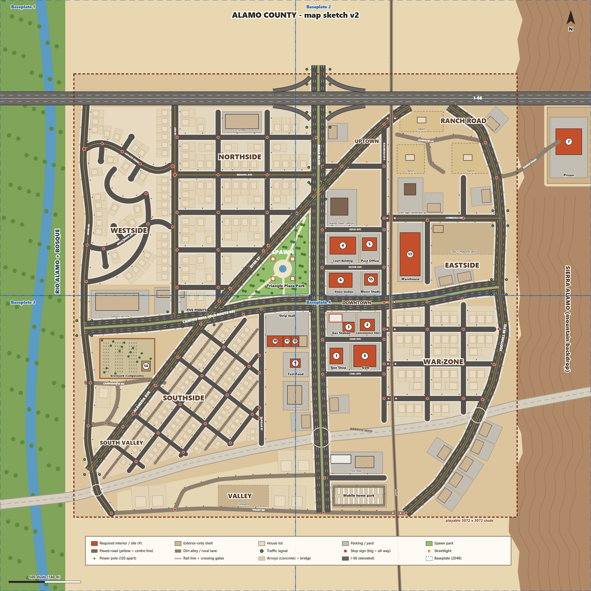

# Alamo County: map sketch v2 and construction plan



Sources: layout data in [`layout.json`](layout.json) (every road, lot, building, junction, light and pole in studs),
generated by `tools/map_layout.py` and drawn by `tools/render_map.py`. Sizes come from
[`standards/SIZING.md`](../../standards/SIZING.md) (door 4.6 × 7.4 × 0.5). Street patterns follow the Albuquerque /
El Paso research.

## 1. Size and shape

| | Studs | Baseplates (2048 each) |
|---|---|---|
| Playable city | 3072 × 3072 | 2.25 |
| With scenery ring (mountains, river + bosque, freeway, desert) | 4096 × 4096 | **4** |

Studio position = `(x - 1536, 0, z - 1536)`, so the main intersection (Camino Real × Mesa Blvd) sits near the
world origin.

### Street network (what makes it feel like a real city)

| Road | Type | Feel |
|---|---|---|
| **Camino Real** (old Route 66) | 6-lane arterial with median | Bends through town from the river to the mountains |
| **Mesa Blvd** | 6-lane arterial with median | Main N-S street. I-66 diamond interchange at the north end; bridges the arroyo |
| **Alameda Ave → Five Points → Dyer St** | 4-lane avenue with turn lane | An **old diagonal highway** cutting SW→NE across the grid. It makes the **Five Points** junction and the **triangle spawn park**, then merges onto I-66 |
| **Foothill Blvd** | 4-lane avenue | Curves along the base of the mountains; Ranch Road climbs off it to the prison |
| **River Rd** | collector | Winds along the river on the west edge |
| **I-66** | elevated freeway | North edge; on/off ramps at Mesa Blvd |
| **Arroyo Seco** | concrete channel | Crosses the south; only **Mesa, Foothill and River Rd** bridge it, so it shapes routes |
| **Rail line** | N-S beside downtown | 7 grade crossings with gates |

Each district has its own street pattern:

| District | Pattern |
|---|---|
| **Downtown** | Tight grid east of Mesa (Gold, Silver, Lead, Coal Ave, Railroad Ave), short blocks |
| **Uptown** | Offices and the Alamo Tower where Dyer St crosses Mesa |
| **Northside** | 1960s long blocks: streets 260 apart, back-to-back lots, ending at an angle against the diagonal |
| **Westside** | Curving subdivision: Coyote Trail, Mesa Verde Dr, Sunset Loop, cul-de-sacs |
| **Southside (barrio)** | Grid **rotated to the diagonal**, narrow streets, **dirt alleys** behind every block |
| **War Zone** | Wide grid of fourplexes between the rail line and Foothill Blvd; N-S streets dead-end at the arroyo fence |
| **Eastside** | Big industrial blocks, rail spur, dead-end dock streets |
| **Ranch Road** | Winding dirt lanes, big ranch lots, the prison on a bench under the mountains |
| **South Valley / Valley** | Rural lanes along the river and south of the arroyo: graveyard, mobile home park, junkyard, truck stop |

### Why it's still easy to navigate
- **Spawn is the big triangle**: three major roads (Camino Real, Mesa Blvd, Dyer St) border it, so you can see it from
  everywhere.
- The civic block (Court, Post Office, Police, Music Studio) faces the park across Mesa Blvd.
- **Natural compass**: mountains east, river west, freeway north, arroyo and desert south.
- **Landmarks**: Alamo Tower (160 tall), grain silos (110), the prison bench, the fountain.
- Every required building except the prison and the graveyard is within ~600 studs of spawn.

## 2. Required buildings and sites

| # | Building | District | Lot | Building W×D×H | Stories | Studio position |
|---|---|---|---|---|---|---|
| 1 | Gun Shop | Downtown | 160 × 188 | 90 × 110 × 18 | 1 | (298, 424) |
| 2 | Convenience Store | Downtown | 156 × 162 | 100 × 80 × 17 | 1 | (506, 197) |
| 3 | Gas Station (6 pumps) | Downtown, corner of Mesa + Camino | 200 × 162 | 80 × 70 × 18 + canopy | 1 | (318, 197) |
| 4 | Court Building | Downtown civic block | 220 × 208 | 180 × 120 × 46 | 3 | (328, -326) |
| 5 | Post Office | Downtown civic block | 136 × 208 | 100 × 90 × 18 | 1 | (516, -326) |
| 6 | Police Station | Downtown, faces the park | 235 × 162 | 160 × 100 × 28 | 2 | (336, -89) |
| 7 | Prison | Ranch Road bench | 260 × 420 | 180 × 180 × 30 + yard | 2 | (1894, -1026) |
| 8 | Gym | Downtown | 196 × 188 | 155 × 150 × 24 | 1 | (486, 424) |
| 9 | Fast Food (drive-thru) | SW corner of Mesa + Camino | 176 × 170 | 70 × 60 × 16 | 1 | (2, 479) |
| 10–12 | Clothing / Hair / Tattoo (strip-mall bays 110 / 55 / 55) | SW corner of Mesa + Camino | 296 × 248 | 276 × 75 × 20 | 1 | (-58, 240) |
| 13 | Warehouse (6 docks on the rail spur) | Eastside | 175 × 410 | 140 × 300 × 34 | 1 | (796, -301) |
| **14** | **Graveyard (Camposanto)** | South Valley, on Camposanto Rd | 380 × 275 | chapel 60 × 70 × 22 | 1 | (-1166, 436) |
| **15** | **Music Studio** | Downtown civic block, by the tracks | 121 × 162 | 90 × 80 × 26 | 2 | (524, -89) |

- **Graveyard**: adobe perimeter wall with an iron gate on Camposanto Rd, a chapel, gravel paths, headstone rows,
  and junipers and cypress. It's a site rather than an interior, but the chapel can open.
- **Music Studio**: an old 2-story brick building by the rail line. Live room, 2 vocal booths, control room, lounge,
  and an alley load-in door.
- **Spawn: Triangle Plaza Park (~144,000 sq studs)**:
  - Central fountain plaza with **4 spawn pads under shade canopies**.
  - Paths to each corner, a gazebo, a map + job kiosk, a basketball court and a playground.
  - Palm and cottonwood groves, bus stops on Camino Real and Mesa Blvd, and a restroom shell.

---

## 3. Construction order

Each phase finishes and is checked before the next starts. Everything goes under `Workspace.Map` in the Alamo County place:

```
Workspace.Map
  Roads/ {Arterial, Avenue, Collector, Local, Lanes, Alleys, Rural, Freeway, Intersections, Sidewalks, Parking, Bridges}
  Utilities/ {Poles, Wires, Streetlights, Signals, Signs, RailCrossings}   Markings/ {Lanes, Crosswalks, Parking, FireLanes}
  Buildings/ {Downtown, Uptown, Westside, Northside, Southside, WarZone, Eastside, RanchRoad, Valley}
  Interiors/   Vegetation/   Props/
```

> **Before phase 1**:
> - The place already has systems in Workspace (NPC folders, JobBoxes, PoliceJail, GunStore, door library). Build
>   under `Workspace.Map` and don't move or delete existing content.
> - Decide whether the old Baseplate goes, or build in a copy of the place first.
> - Import `exports/_scale_check/scale_check.fbx` once and confirm the cube is 2 × 2 × 2 studs.
> - StreamingEnabled on (ModelStreamingBehavior Improved), one Model per building.

### Phase 1: Terrain
1. **Slab**: terrain over the full 4096 × 4096, top at **Y = 0**, at least 64 studs (16 voxels) thick. Fill in
   512-stud chunks with `task.wait()`.
2. **Materials**:
   - Ground (a "SW_Dirt" MaterialVariant) for the city.
   - Sand (a "SW_Caliche" variant) for the desert ring.
   - Grass only for the spawn park, the bosque, the graveyard's inner beds and the ranch pastures.
   - Rock and Sandstone for the mountains; Mud at the river banks; Water in the river.
3. **Mountains (east)**: start at x ≈ 3060 and rise steeply to 700–1,000 studs. Leave a flat **bench** at the NE for
   the prison (x 3280–3600, z 230–760), and have Ranch Road climb a gentle grade up to it.
4. **River and bosque (west)**: a meandering channel 70 wide and 8 deep, with a cottonwood belt.
5. **Arroyo Seco cut**: carve the channel path (60 wide, 10 deep) so the concrete channel mesh drops in during
   phase 2. Add gentle grade changes at the 3 bridges.
6. **North**: a mesa edge under the elevated I-66. **South**: open desert, the rail embankment, Valley Rd.
7. **Method**: generate a heightmap + colormap from `layout.json` (1 px = 4 studs). Import it with Terrain Editor →
   Import, then hand-sculpt the mountains. No terrain edits in Team Create.
8. **Map edge**: invisible walls on the outer 4096 edge and along the mountain base.

**Done when:** the full 4096 square is walkable and drivable, the city is flat at Y = 0, the arroyo cut matches the
layout, and the prison bench is reachable by Ranch Road.

### Phase 2: Roads, parking lots and sidewalks

| Class | Length (studs) | Curb-to-curb | Width incl. sidewalks | Layout |
|---|---|---|---|---|
| Arterial (Camino Real, Mesa Blvd) | 6,000 | 100 | 120 | 3 + 3 × 14, 16 median, 10 sidewalks |
| Avenue (Alameda/Dyer, Foothill) | 6,540 | 70 | 90 | 2 + 2 × 14, 14 turn lane |
| Collector (River Rd, Ash St, Menaul Ave, Coyote Trail, Commerce Rd) | 6,760 | 48 | 64 | 1 + 1, parking both sides |
| Local streets (incl. 5 cul-de-sacs, 44-stud bulbs) | 17,190 | 36 | 52 | 2-way, no lines |
| Barrio lanes | 5,070 | 30 | 42 | narrow, 6 sidewalks |
| Alleys | 4,070 | 18 | 18 | dirt / broken asphalt |
| Rural lanes (Ranch Rd, Corrales, Camposanto, Valley Rd…) | 5,680 | 28 | 28 | dirt shoulders |
| I-66 + 4 ramps | 4,100 + 1,150 | 88 / 22 | 88 / 22 | elevated deck on piers |
| **Total** | **~56,500** | | | |

1. **Blender road kit** (one mesh per piece, so every copy shares a MeshId):
   - **Straight tiles**: 64-stud lengths per class.
   - **Curve tiles**: 15°/30°/45° bends, plus a radius set for the Westside curves and Foothill Blvd.
   - **Intersection pads**: 90° pads for every class combination, **angled pads for the diagonal** (Five Points, and
     Dyer × Mesa / grid streets at ~50°), T pads, and cul-de-sac bulbs.
   - **Curbs and sidewalks**: curb returns, sidewalk strips with corner ramps, driveway cuts (12 residential, 24
     commercial).
   - **Medians**: 16-stud arterial median planters; avenue turn-lane paint is baked in.
   - **Lots**: parking slabs, the gas-station apron.
   - **Structures**: 3 arroyo bridges plus the rail bridge, the concrete channel itself, the I-66 deck, piers and
     ramps, and rail track pieces with crossing pads.
2. **Heights**: road surface top 0.2; curb 0.55 above it, so sidewalks and lots sit at 0.75.
3. **Collision**: meshes CanCollide off. Invisible Box parts per tile (CanQuery on for car raycasts).
4. **Placement**: a Studio script reads `layout.json` (as a ModuleScript), sweeps tiles along every polyline, and
   drops pads at every junction it lists. Batches with `task.wait()`.
5. **Parking lots** for every commercial lot and site. Stalls 11 × 22, aisles 24.

**Done when:** the fastest car drives Camino Real, Mesa Blvd, the diagonal, Foothill Blvd and I-66 with no bumps at
seams; every road in `layout.json` exists; render stats show instanced road meshes.

### Phase 3: Power lines, signs and streetlights

| Item | Rule | Count (from layout) |
|---|---|---|
| Wooden utility pole (34 tall, crossarm, transformer variant) | 3 behind the sidewalk on one side of every local, lane, collector, rural lane and alley, every 120 | ~326 |
| Wires | **Beams** between pole attachments (CurveSize for sag), 3 per span | ~900 spans |
| Streetlights | arterials and avenues both sides every 100; collectors one side every 120 (pole-mounted on utility poles where they exist) | ~311 |
| Signal mast-arm sets | arterial/avenue crossings + ramp ends | 13 intersections |
| Stop signs (+ all-way plaques) | every local/lane/rural junction | 93 stop + 3 all-way |
| Rail crossing gates + crossbucks | both sides of every crossing | 7 crossings |
| Street-name blades, speed limits, one-way, no parking, bus stop, I-66 guide signs | every junction / block | ~150 |

- One instanced mesh per prop. Only the pole bases collide.
- Night lights: SpotLight on arterial/avenue lights only, Shadows off, one script turns them on.

**Done when:** every street has poles and wires, every junction has the right control, and the rail crossings have
gates and signals.

### Phase 4: Road markings, parking stripes, fire lanes and tow signs
- **Lane paint is baked into road tile textures**: dashed lane lines, double yellow on avenues and collectors, median
  edges. Tile variants near junctions get stop bars (2 wide), continental crosswalks (2 × 9 bars), turn arrows, and
  the avenue turn-lane arrows. No Decals.
- **Parking**: one instanced stripe mesh (0.5 wide) on 11 × 22 stalls. Blue ADA stalls nearest each entrance.
- **Fire lanes**:
  - In front of every interior building, along the strip-mall storefronts, at the prison sally port and the police
    station entrance.
  - Red curb tile variant with "FIRE LANE – NO PARKING" stencils every 40, plus signs.
- **Loading zones**: yellow curb at the Post Office dock, the Warehouse docks, the Music Studio alley load-in and the
  gas-station fuel drop.
- **Tow-away signs** at every commercial lot entrance (~40), with a **fictional towing company**.
- **Rail crossings**: RXR pavement marking and stop line on both approaches.
- **Bus stops**: shelter pads on Camino Real and Mesa Blvd at the park.

### Phase 5: Exterior-only buildings (shells)
- **Houses (222 lots)** from about 9 Blender variants, 3–5k tris each, varied with texture sets and rotation:
  - flat-roof stucco ×3 (Westside, War Zone)
  - pitched ranch ×2 (Northside)
  - brick barrio row ×2 (Southside)
  - fourplex (War Zone)
  - mobile home ×2 (Valley)
- **Lot dressing kit per district**: CMU wall, river-rock wall, iron fence on stucco pillars, coyote fence,
  chain-link, alley gates.
- **Shells**: Alamo Tower, grain silos, school, motel, grocery big box, church, truck stop, tow-yard office, ranch
  houses, about 14 strip-shop shells along the arterials.
- **Order**: the civic block and the park edges first (seen from spawn), then arterial frontage, then the
  neighborhoods.

**Done when:** no empty lots remain, and render stats stay under budget at spawn and at Five Points.

### Phase 6: Interior buildings (13 interiors + the graveyard site)
Each one runs through the `build-building` workflow.

1. **Everyday jobs first**: Gas Station (#3), Convenience Store (#2), Fast Food (#9).
2. **Law loop**: Police (#6), Court (#4), Prison (#7).
3. **Customization**: Gun Shop (#1), Clothing (#10), Hair (#11), Tattoo (#12).
4. **The rest**: Music Studio (#15), Gym (#8), Post Office (#5), Warehouse (#13), Graveyard (#14).

**Interior rules:**
- Ceilings 10 / 12. Rooms ≥ 9 × 9, corridors ≥ 9.
- Public entrances are double doors (9.2), with the 4.6 × 7.4 door elsewhere.
- Split wall collision around every opening. Reuse the existing door library after a size check.
- The Music Studio's booths need sound-proof door props, and its live room needs at least 12 ceiling for the camera.

> **Decision needed**: real walk-in interiors or teleport interiors? The place already has `Interiors` and
> `InteriorLayouts` folders.

### Phase 7: Final touches
- **Vegetation**: cottonwood and Siberian elm (bosque, barrio, Northside), fan palms (downtown, arterials), juniper,
  yucca, chamisa, gravel beds, cypress in the graveyard.
- **Street life**: dumpsters in the alleys, bins, bus shelters, benches, hydrants, mailboxes, shopping carts,
  rooftop swamp coolers, satellite dishes, parked cars, murals in the barrio, sparse graffiti, potholes and patches.
  All signage uses **fictional brands**.
- **Lighting and sound**: LightingStyle Soft, warm sun, light dust haze, desert skybox. Audio zones for freeway hum,
  train horns at the crossings, wind at the arroyo, and the park fountain.
- **Gameplay hooks**: SafeZone over the spawn park, job markers, minimap re-bake, ATMs and phones.
- **Performance pass**: test on a 2–3 GB phone, test streaming at top car speed on I-66, turn on SLIM for static
  buildings, and turn off collision, touch, query and shadows on decor.

---

## 4. Next steps
1. Owner signs off on the layout. To change it, edit `tools/map_layout.py`, then run it and `tools/render_map.py`.
2. Build the **greybox generator**: a Studio script that reads `layout.json` and places flat road strips, lot pads
   and building blocks at true size under `Workspace.Map`, so the layout can be walked and driven with R6 before
   any art.
3. Start phase 1.
